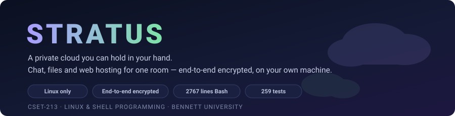
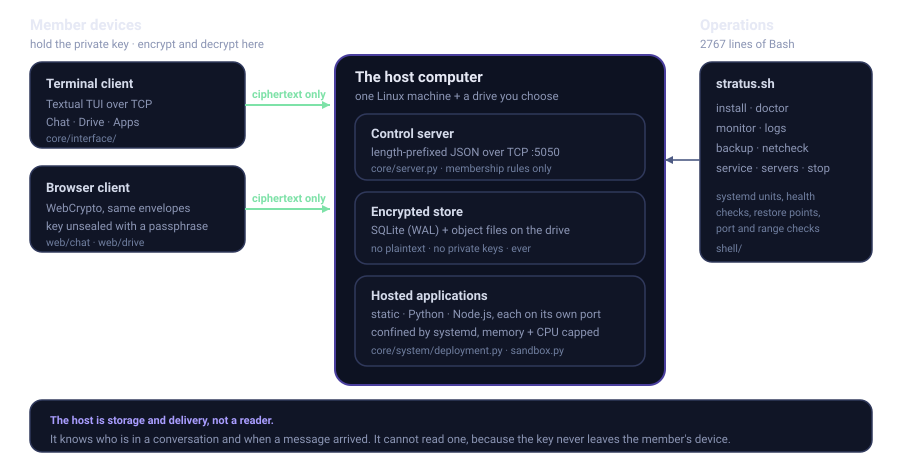
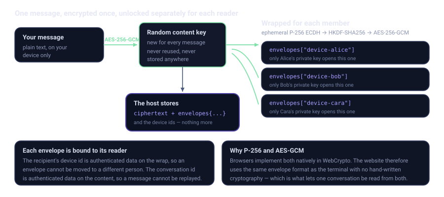

<p align="center">
  
</p>

<p align="center">
  
  
  
  
  
</p>

---

## What Stratus is

Take one Linux computer and a drive — an old laptop, a spare desktop, a USB
disk you carry in your bag — and Stratus turns it into a **private cloud for the
people in the room with you.**

They join over the local Wi-Fi and get three things:

- **Encrypted chat** — group and one-to-one, from a terminal or a browser
- **An encrypted drive** — upload, share with a person or a group, download
- **Web hosting** — anyone in the room can upload a small website or app and it
  goes live on the network in seconds

Everything stays on the drive you chose. Nothing touches the internet. No
account, no company, no subscription, no data leaving the building.

**And the person hosting it cannot read any of it.** That is not a promise about
good behaviour — it is a property of the design. The host stores ciphertext and
a list of who a message was sealed for. The keys never leave the members'
devices. The host knows *who* is talking and *when*; never *what*.

> Built for **CSET-213 Linux & Shell Programming** at Bennett University, but
> built to actually work — not to be demonstrated once and thrown away.

---

## Get it running

### 1. Clone

```bash
git clone https://github.com/Shaurya1510/stratus.git
```

```bash
cd stratus
```

> **Note:** while this repository is private, cloning requires a GitHub account
> that has been added as a collaborator, authenticated with a Personal Access
> Token, an SSH key, or `gh auth login`.

### 2. Install the dependencies

Stratus checks for everything it needs and tells you exactly what is missing,
with the install command for your distribution:

```bash
./stratus.sh install
```

That covers the system tools (`python3`, `tar`, `lsblk`, `findmnt`, `ip`, `ss`,
`sqlite3`) and then the two Python packages. If you would rather do it by hand:

**Debian / Ubuntu / Mint / Pop!\_OS**

```bash
sudo apt update && sudo apt install -y python3 python3-pip python3-venv util-linux iproute2 sqlite3 tar
```

**Fedora / RHEL / CentOS**

```bash
sudo dnf install -y python3 python3-pip util-linux iproute sqlite tar
```

**Arch / Manjaro**

```bash
sudo pacman -S --needed python python-pip util-linux iproute2 sqlite tar
```

Then the Python packages — `cryptography` for the encryption and `textual` for
the terminal interface:

```bash
pip3 install --user -r requirements.txt
```

**Optional but recommended.** `./stratus.sh install` offers to install these
for you; you can also do it by hand:

```bash
sudo apt install -y nodejs npm ufw
```

- **`nodejs` + `npm`** — only if you want to host Node.js projects
- **`ufw`** — lets Stratus open firewall ports for hosted apps automatically
- **`systemd` with lingering enabled** — this is what confines uploaded
  applications so they cannot read your files. Turn it on with
  `sudo loginctl enable-linger $USER`. Without it, Stratus **refuses** to run
  guest applications rather than running them unprotected.

<details>
<summary><b>If the Python environment fails with <code>No module named 'pip'</code></b></summary>

Debian, Kali and Ubuntu package Python's `ensurepip` separately from `venv`, so
a virtual environment can be created successfully and still contain no pip.
`./stratus.sh install` detects this and rebuilds the environment, but if it
tells you `ensurepip` itself is missing, install it:

```bash
sudo apt install -y python3-venv python3-pip
```

On some releases the package is tied to a specific Python version. Find it with:

```bash
apt search '^python3.*-venv$'
```

</details>

### 3. Check everything is healthy

Run this **before** starting anything. It is faster to be told what is wrong
than to find out from a failure later:

```bash
./stratus.sh doctor
```

Twenty-plus checks on dependencies, permissions, storage, ports, the network,
and whether guest confinement is actually available on this machine. Every
failure comes with the command that fixes it.

Two warnings are normal on a fresh machine — *no device identity yet* and *no
server created yet*. Both are created the first time you host or join.

### 4. Start it

```bash
./stratus.sh
```

That is the whole thing. One command opens a full-screen interface that walks
you through hosting a server or joining someone else's — choosing a drive,
naming the server, setting a join token, and picking how much of the machine
guests may use.

### 5. Stopping it

The server keeps running when you close its terminal. That is deliberate — a
machine people are relying on should not go down because someone shut a window.
It does mean that closing that terminal leaves a server running with nothing on
screen to stop it, and the next start refuses because only one may run at a
time.

This is the way back:

```bash
./stratus.sh stop
```

It stops the control server, stops every application it was hosting, and clears
the record so you can start again. Nothing stored is deleted.

To see what is running without stopping anything:

```bash
./stratus.sh stop --status
```

To stop only the hosted applications and leave the server up:

```bash
./stratus.sh stop --apps
```

---

## What you can do with it

### Encrypted chat

- **General**, **group**, and **one-to-one** conversations
- **Read the same conversation from the terminal or a browser** — the website
  is not a separate chat, it is the same encrypted messages decrypted in a
  different place
- **Attachments** from either side, encrypted for exactly the people in that
  conversation
- Unread badges, date separators, grouped message runs
- A line at the top of every conversation naming **exactly who can read it**,
  because that is the whole point
- **Trust on first use** — if a member's encryption key ever changes, the client
  stops rather than quietly accepting it

### Encrypted drive

- Upload anything up to 10 MB; **filenames are encrypted too**, not just contents
- Four scopes: **private**, **everyone on the server**, **one person**, or **a group**
- Create groups and pick members while you are sharing, not in a separate screen
- Navigate by **who a file is shared with** — your own files, a specific person,
  a group, or everything
- **Search decrypted filenames** without the host ever seeing them
- Terminal and browser show the same drive with the same navigation

### Web hosting

Upload a folder with a small manifest and it goes live:

```yaml
name: My Portfolio
runtime: static          # or python, or node
start: python3 -m http.server $PORT
```

- **Three runtimes** — static sites, Python, and Node.js with real build steps
  (`pip install`, `npm ci`, and your own `build:` command)
- **A live URL on the local network**, ready in seconds
- **Start, stop, restart and read live logs** from the interface
- **Host approval** — you see what an upload does before it runs
- Two working examples in [`examples/`](examples/) to copy from

### Running the machine

Nine Bash tools, because this is a shell programming project:

| Command | What it does |
|---|---|
| `./stratus.sh install` | Check and install every dependency, per distribution |
| `./stratus.sh doctor` | 20+ health checks with plain-English fixes |
| `./stratus.sh monitor` | Live dashboard — CPU, memory, disk, per-app resource use |
| `./stratus.sh logs` | Follow, search and filter application and server logs |
| `./stratus.sh backup` | Create, list, verify and restore snapshots of a server |
| `./stratus.sh netcheck` | Address, subnet, ports, firewall and reachability checks |
| `./stratus.sh service` | Install Stratus as a hardened systemd user service |
| `./stratus.sh servers` | List servers, scan a drive for others, remove or delete one |
| `./stratus.sh stop` | Stop the server and its applications; recover from a closed terminal |

Every one answers `--help`, and there is a line-by-line explanation of all of
them in **[docs/GUIDE.md](docs/GUIDE.md)**.

---

## How it fits together

<p align="center">
  
</p>

The host runs a small control server speaking length-prefixed JSON over TCP. It
decides **membership** — who may read what — and stores what it is given. It has
no way to read any of it.

Both front-ends go through the **same membership module**, so the website can
never accidentally be more permissive than the terminal. That is the kind of gap
that quietly turns into a data leak, so the rules live in exactly one file.

### The encryption

<p align="center">
  
</p>

Every message and file is encrypted **once** with a fresh random content key.
That key is then wrapped **separately for each authorised reader** using
ephemeral P-256 ECDH, HKDF-SHA256, and AES-256-GCM.

P-256 and AES-GCM were not chosen at random. Browsers implement both natively in
WebCrypto, so the website uses the **same envelope format** as the terminal with
no hand-written cryptography anywhere. That is the thing that makes one
conversation readable from both places.

**Browser access** is the interesting problem: the website needs your private
key, but sending it through the host would defeat the entire design. So the key
is sealed with a passphrase the host never sees — PBKDF2-SHA256 at 600,000
iterations, then AES-256-GCM. The host stores a blob it cannot open and hands it
back on request. Your browser unseals it locally.

Full detail in **[docs/SECURITY.md](docs/SECURITY.md)**.

---

## Security

The project was reviewed before publication. **Five real issues were found and
fixed** — each one reproduced first, rather than guessed at, and each with a
regression test that was verified to fail against the original code.

| Issue | Severity | Fixed by |
|---|---|---|
| Path traversal through a client-chosen device id | High | Validating the id where a device enters the system |
| A hosted app could become the host (loopback = admin, token readable in `/proc`) | High | Admin bound to the host's own device, token moved to a private file, `/proc` hidden from guests |
| Build steps (`pip install`, `npm install`, `build:`) ran outside the sandbox | High | Confining the build, not only the finished app |
| Script injection through an HTML attribute | Medium | Escaping quotes as well as angle brackets |
| Join token written into the systemd unit | Low | A separate file, referenced by path |

Defences that were already in place and verified:

- **Uploaded archives** are checked for path traversal, symlinks, hardlinks and
  decompression bombs before a single byte is written
- **Confinement fails closed** — if the machine cannot confine a guest app,
  Stratus refuses to run it rather than running it unprotected
- **A review screen, not a virus scanner** — it reports what an upload *does*
  (reads outside its folder, starts programs, sends data out) so approval is an
  informed decision. It does not pretend to detect malware, because fresh
  malicious code matches no signature and claiming otherwise is worse than
  saying nothing
- **Join by network range** — restrict which addresses may connect at all, so
  not everyone on the Wi-Fi can even reach the door

**[docs/SECURITY.md](docs/SECURITY.md)** documents all of this, including six
**known limitations** stated plainly — most importantly that messages are
encrypted but **not signed**, so confidentiality holds against a malicious host
but authorship does not.

---

## Project layout

```
stratus.sh              One entry point for everything
shell/                  2,767 lines of Bash — the operations toolkit
  ├── lib/common.sh     Shared colours, logging, guards, helpers
  ├── install.sh        Dependency detection and installation
  ├── doctor.sh         Health checks
  ├── monitor.sh        Live resource dashboard
  ├── logs.sh           Log viewing and search
  ├── backup.sh         Snapshot and restore
  ├── netcheck.sh       Network diagnostics
  ├── service.sh        systemd service installation
  ├── servers.sh        Multi-server management
  └── stop.sh           Stop a running server and its applications
core/                   The platform
  ├── security/         Envelope encryption, identity, passphrase sealing
  ├── platform/         Database, membership rules, wire protocol, session
  ├── system/           Storage, sandbox, deployment, network, registry
  ├── interface/        The Textual terminal application
  ├── server.py         The control server
  └── client.py         The joining client
web/                    The two built-in websites
  ├── chat/             Flask + WebCrypto
  └── drive/            Flask + WebCrypto
tests/                  212 tests
docs/                   Guide, architecture, hosting, security, testing
examples/               Two ready-to-deploy sample projects
```

Every folder has its own `README.md` explaining what lives there and why.

---

## Documentation

| Document | What it covers |
|---|---|
| **[docs/GUIDE.md](docs/GUIDE.md)** | Every folder and every script, explained line by line |
| **[docs/ARCHITECTURE.md](docs/ARCHITECTURE.md)** | How the pieces fit and why they were split that way |
| **[docs/HOSTING.md](docs/HOSTING.md)** | Writing and deploying your own project |
| **[docs/SECURITY.md](docs/SECURITY.md)** | Threat model, encryption design, review findings, limitations |
| **[docs/TESTING.md](docs/TESTING.md)** | How the tests are organised and how to run them |

---

## Running the tests

```bash
./stratus.sh test
```

212 tests covering the encryption (including **Python ↔ JavaScript interop**,
proved by running the real browser crypto under Node), the membership rules,
the wire protocol, archive safety, the sandbox, drive discovery, the terminal
interface, and every security fix listed above.

---

## Scope and honesty about it

**What this is:** a working private cloud for a room of people who already trust
each other with a shared computer. A classroom, a lab, a hostel floor, a team
working offline.

**What this is not:** a replacement for a real cloud provider. It is deliberately
local-network, deliberately small, and the limitations are written down rather
than hidden.

Specific things it does **not** do, and does not claim to:

- **Defend against a hostile host with physical access.** The host controls the
  machine. It cannot read stored messages, but it could modify the software it
  serves.
- **Hide metadata.** The host necessarily knows who is in a conversation and
  when. Only content is protected — this is the design, not an oversight.
- **Detect malware.** See the review screen note above.
- **Run on Windows or macOS.** Linux only, and it says so rather than half-working.

---

## Team

**Group project — CSET-213 Linux & Shell Programming, Bennett University**
Supervisor: **Nitin Shukla**

| Name | Enrolment |
|---|---|
| Vivaswaan Singh Shekhawat *(Team Lead)* | S25CSEU0682 |
| Shaurya Jain | S25CSEU0633 |
| Vansh Negi | S25CSEU0671 |

---

## Licence

Coursework for Bennett University. Not licensed for redistribution.
